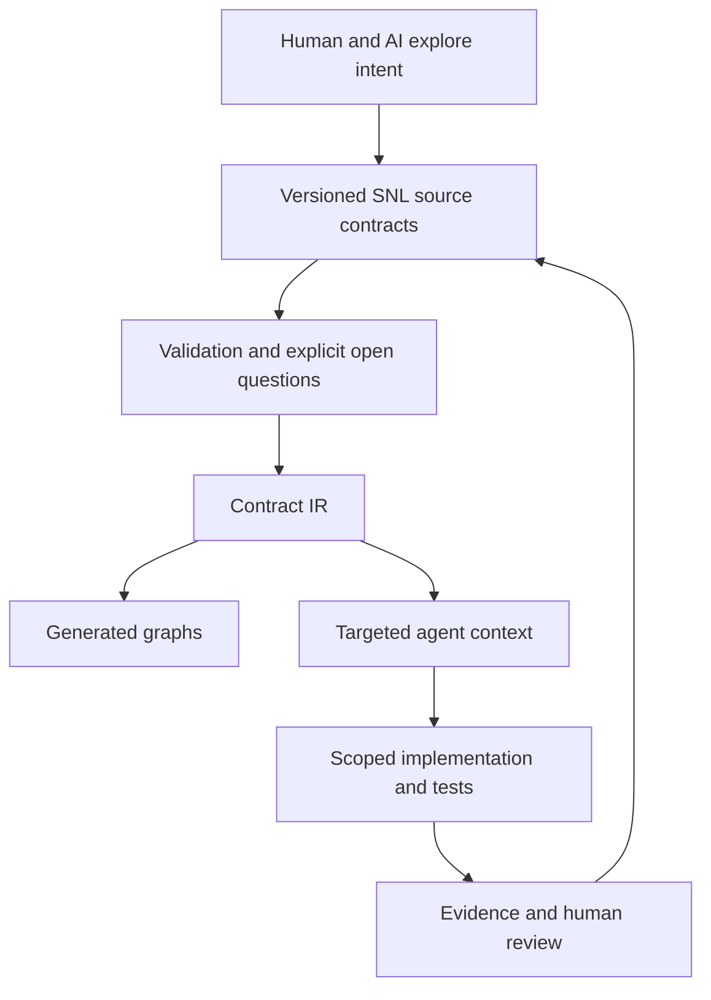

# SNL · Structured Natural Language

**Living contracts for humans and AI to build software together.**

[中文](README.zh-CN.md) · [Start with an example](docs/first-example.md) · [Roadmap](ROADMAP.md) · [Contribute](CONTRIBUTING.md) · [Discussions](https://github.com/BeautyChaser/SNL/discussions)

AI can produce code quickly. Keeping intent, interfaces, assumptions, and evidence aligned as a project changes is harder. SNL explores a shared, versioned software definition that humans and AI can question, refine, implement, and verify together.

The idea is to express public contracts in structured natural language: inputs and outputs, ownership, dependencies, observable behavior, side effects, acceptance criteria, and unresolved questions. AI helps maintain these definitions and their implementations; people make the key decisions about intent and acceptable behavior.

> **Status: design and community exploration.** This repository contains the founding design documents, candidate examples, and a proposed implementation plan. There is no runnable `snl` CLI or released language standard yet. Python, YAML, command names, and schema fields remain implementation proposals.

## What we want to make possible

- **A living specification.** Drafts, questions, experiments, and reviewed baselines coexist. An unreviewed revision must not silently replace an effective contract.
- **Work within a clear scope.** Each development step has a target, allowed changes, interfaces, acceptance evidence, and stopping conditions.
- **Trace decisions to evidence.** Stable contract and workflow IDs connect definitions to source code, tests, and review records.
- **Keep implementation freedom.** Define public behavior while allowing an AI or developer to choose internal classes and algorithms.
- **Improve existing systems gradually.** Extract a capability from a working black box while retaining and testing the remaining behavior.
- **Share the right context.** Assemble relevant contracts for a particular agent role and context budget without silently losing essential clauses.

## The proposed workflow

**SNL-first · Graph-generated · GUI-optional.** Text is the source of truth; IR, graphs, and context bundles are derived from it. The intended tool is independent of model providers, IDEs, GUIs, and application domains.

Natural-language statements may need human review. Passing a schema check does not prove a business rule correct. A future scope checker detects changes; hard isolation requires the execution environment to enforce permissions.

## Start here

1. Read the [parameter-preparation walkthrough](docs/first-example.md) to see a concrete problem.
2. Explore the [vision](design-handoff/docs/01_vision_and_invariants.md), [living specification model](design-handoff/docs/04_living_specification.md), and [decision ledger](design-handoff/docs/10_decision_ledger.md) (Chinese).
3. Pick an [open question](design-handoff/docs/11_open_questions.md) or a [roadmap task](ROADMAP.md).
4. Bring a counterexample, a real workflow, a small experiment, or a focused pull request.

## Help shape SNL

We welcome developers, AI tooling builders, software architects, researchers, technical writers, and people with frustrating AI-assisted development stories. Challenging the approach is a useful contribution.

Questions we especially want to explore:

- Which contracts help an agent make better changes, and which only add maintenance work?
- How should drafts and reviewed baselines coexist as both code and intent change?
- What evidence distinguishes a successful local change from a plausible-looking one?
- How can context bundles preserve essential constraints within a limited budget?
- How should SNL integrate with existing agents and specification tools?

Use [Discussions](https://github.com/BeautyChaser/SNL/discussions) for open-ended ideas and [Issues](https://github.com/BeautyChaser/SNL/issues) for concrete proposals, cases, and implementation tasks. Chinese and English contributions are welcome. See [CONTRIBUTING.md](CONTRIBUTING.md).

## Repository map

| Path | Purpose |
| --- | --- |
| [docs/first-example.md](docs/first-example.md) | English introduction through a concrete scenario |
| [ROADMAP.md](ROADMAP.md) | Proposed milestones and observable completion criteria |
| [CONTRIBUTING.md](CONTRIBUTING.md) | How to contribute ideas, cases, experiments, and code |
| [GOVERNANCE.md](GOVERNANCE.md) | Current decision and review process |
| [design-handoff/](design-handoff/) | Original design handoff, preserved with its integrity manifest |
| [docs/provenance.md](docs/provenance.md) | Source provenance and current repository status |

The handoff contains future implementation prompts. They are reference material, not evidence of implemented features or instructions to start the entire MVP automatically.

## License

[MIT](LICENSE) · Copyright © 2026 BeautyChaser and SNL contributors.
